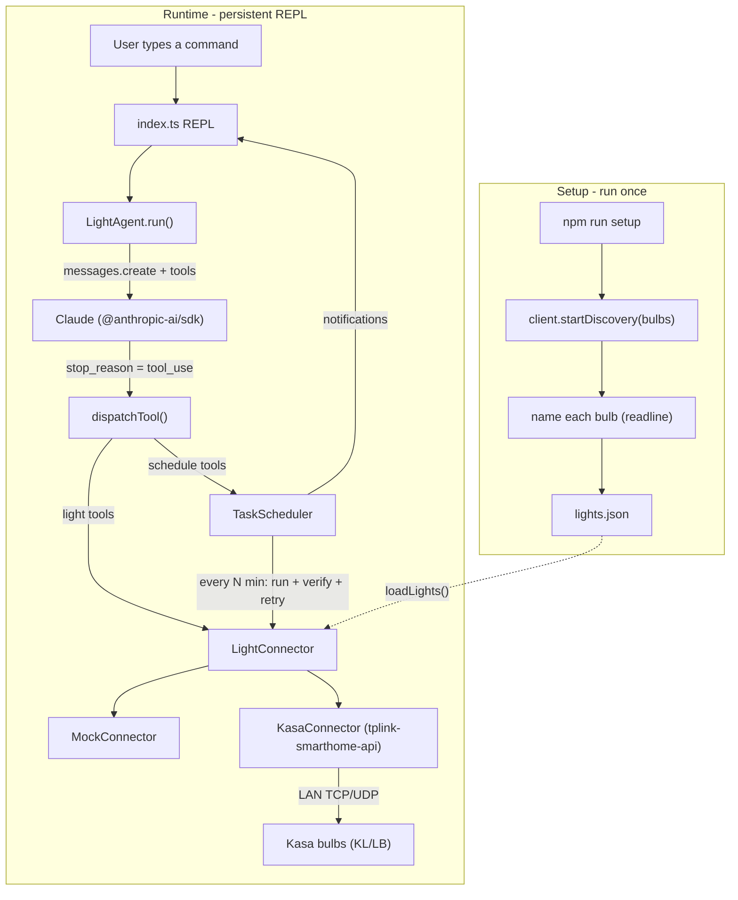
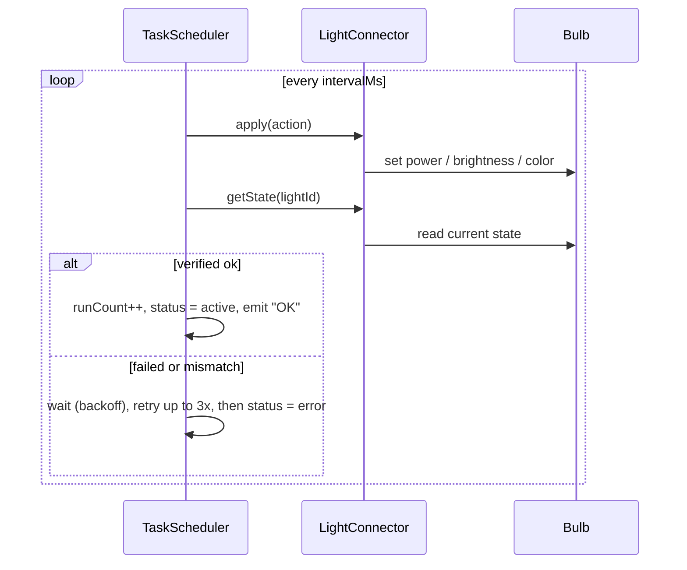

# Light Agent - Project Plan & Design

> Full design reference for contributors. This is a living document - keep it updated as the
> design evolves. For a quick agent-oriented summary see `CLAUDE.md`; for current progress and
> the changelog see `PROGRESS.md`.

## 1. What it is
A CLI TypeScript application: an AI agent that controls TP-Link Kasa WiFi bulbs from natural
language. You talk to it in a terminal REPL (e.g. "turn on the living room light", or
"cycle the kitchen color every 5 minutes"); Claude interprets the request and calls tools; a
connector drives the bulbs; a scheduler runs recurring tasks with an execute -> verify -> retry loop.

## 2. Features
- Natural-language control via Claude (Anthropic tool use / function calling).
- One-time setup/onboarding that discovers Kasa bulbs on the LAN and names them.
- Recurring task "loop engine": schedule an action on an interval; each tick executes, verifies,
  and retries on failure.
- Swappable hardware backends behind a single interface (`MockConnector` for dev, `KasaConnector`
  for real bulbs; future: Hue, LIFX).

## 3. Tech stack
| Concern   | Choice |
|-----------|--------|
| Language  | TypeScript (ESM, `module`/`moduleResolution`: NodeNext), strict mode |
| Runtime   | Node.js 24 |
| Runner    | `tsx` (runs `.ts` directly, no build step); `typescript` used only for `npm run typecheck` |
| LLM       | `@anthropic-ai/sdk` (Claude) |
| Hardware  | `tplink-smarthome-api` v5 (Kasa local LAN control) |

## 4. Architecture
Four responsibilities, kept deliberately separate so each can be built and tested in isolation:

- Connector (`src/connector/*`) = hands. Implements `LightConnector`. Talks to the bulbs.
- Agent (`src/agent/*`) = brain. Claude picks tools from natural language in a tool-use loop.
- Scheduler (`src/scheduler.ts`) = loop engine. Owns recurring tasks and the verify/retry logic.
- Tools (`src/agent/tools.ts`) = the bridge. Declares what the brain may ask the hands/scheduler to do.



Data flow: the REPL reads a line and calls `LightAgent.run(text)`. The agent sends the text plus
the tool schemas to Claude. Claude replies either with a final answer or with tool calls; the agent
executes each tool via `dispatchTool` (routing to the connector or the scheduler), feeds the results
back, and loops until Claude produces a final answer, which the REPL prints.

## 5. Project structure
```
light-agent/
  CLAUDE.md              agent-oriented quick guidance
  PLAN.md                this document (full design)
  PROGRESS.md            progress + changelog
  package.json           scripts: agent, setup, typecheck; type: module
  tsconfig.json          ES2022 + NodeNext + strict
  .env / .env.example    ANTHROPIC_API_KEY (+ optional CLAUDE_MODEL, LIGHT_CONNECTOR)
  .gitignore             ignores node_modules, dist, .env, lights.json
  src/
    types.ts             contracts: Power, LightState, DeviceInfo, LightConnector, TaskAction, TaskStatus, ScheduledTask
    config.ts            env + loadLights()/saveLights() (lights.json)
    setup.ts             `npm run setup` entry: discover + name + persist
    index.ts             `npm run agent` entry: persistent readline REPL, owns the scheduler
    scheduler.ts         TaskScheduler loop engine
    connector/
      mockConnector.ts   in-memory LightConnector (no hardware)
      kasaConnector.ts   real bulbs via tplink-smarthome-api
    agent/
      tools.ts           Anthropic tool schemas (light + schedule_* tools)
      systemPrompt.ts    buildSystemPrompt(lights)
      lightAgent.ts      the tool-use loop + dispatchTool()
```

## 6. Components in detail

### 6.1 `types.ts` - the contracts
The single source of truth for shared shapes. `LightConnector` is the key seam: the agent and
scheduler depend only on this interface, never on a concrete connector.

- `Power = "on" | "off"`
- `LightState { power; brightness?; hue?; saturation? }` (brightness 0-100, hue 0-360, saturation 0-100)
- `DeviceInfo { id; alias?; host?; model?; mac? }` - a known light. `id` is the friendly name used
  in commands; `host` is the LAN IP. Note: `KasaConnector` requires a `host` to reach a bulb, so for
  real hardware `host` must be populated (by `setup.ts`).
- `LightConnector { listLights; getState; setPower; setBrightness; setColor }` - all async.
- `TaskAction` - a discriminated union on `type`: `setPower | setBrightness | setColor | cycleColor`.
- `TaskStatus = "active" | "error" | "stopped"`.
- `ScheduledTask { id; lightId; description; intervalMs; action; status; runCount; lastRun?; lastError? }`.

### 6.2 `config.ts` - env + persisted registry
- Loads `.env` via Node's built-in `process.loadEnvFile()` (wrap in try/catch).
- Exports `ANTHROPIC_API_KEY`, `CLAUDE_MODEL` (default e.g. `claude-sonnet-4-5`), and
  `CONNECTOR` (`"mock" | "kasa"` from `process.env.LIGHT_CONNECTOR`).
- `loadLights(): DeviceInfo[]` reads `lights.json` (returns `[]` if missing).
- `saveLights(lights)` writes `lights.json` (used by `setup.ts`). Resolve the path relative to the
  module via `import.meta.url` + `node:path`.

### 6.3 `connector/mockConnector.ts` - dev without hardware
`class MockConnector implements LightConnector`, backed by a `Map<string, LightState>` seeded from
the provided `DeviceInfo[]`. Each method logs and mutates in-memory state. Lets you exercise the agent
and scheduler with zero bulbs.

### 6.4 `connector/kasaConnector.ts` - real bulbs
Wraps `tplink-smarthome-api`, resolving friendly `id` -> `host` from the registry.
- `const bulb = await client.getDevice({ host })` returns `Bulb | Plug`; narrow/cast to `Bulb` to use `.lighting`.
- `setPower`: `bulb.setPowerState(power === "on")`.
- `setBrightness`: `(bulb as any).lighting.setLightState({ brightness })`.
- `setColor`: `(bulb as any).lighting.setLightState({ hue, saturation, color_temp: 0 })`.
- `getState`: read `bulb.getSysInfo()` / `getPowerState()` and map to `LightState`.
- Optional `discover()` helper shared with setup.

### 6.5 `scheduler.ts` - the loop engine
`class TaskScheduler(connector, onEvent)`. `schedule(task)` stores the task and starts a
`setInterval(intervalMs)`, returning a short id. Each tick runs up to N attempts:



- `apply(task)` maps `TaskAction` to a connector call. `cycleColor` keeps a per-task hue counter and
  advances it each tick (this powers "change the colors every 5 minutes").
- `list()`, `cancel(id)`, `cancelAll()` manage tasks (clearInterval + remove).
- Ids from `node:crypto` `randomUUID`. `setInterval` keeps the process alive, so the REPL must stay open.

### 6.6 `agent/tools.ts` - Claude tool schemas
An `Anthropic.Tool[]` with JSON `input_schema`. Light tools (`list_lights`, `get_state`, `set_power`,
`set_brightness`, `set_color`) map to the connector; scheduling tools (`schedule_recurring_task`,
`list_scheduled_tasks`, `cancel_scheduled_task`) map to the scheduler. Each `description` matters - it
is how Claude decides which tool to call.

### 6.7 `agent/systemPrompt.ts`
`buildSystemPrompt(lights)` explains the app controls home lights, lists the available light ids,
describes the tools and the allowed `TaskAction` shapes, and instructs Claude to ask for clarification
when a request is ambiguous.

### 6.8 `agent/lightAgent.ts` - the tool-use loop
`class LightAgent(client, connector, scheduler, model, lights)`. `run(userInput)` builds the message
list, calls `client.messages.create({ model, max_tokens, system, tools, messages })`, and loops: while
`stop_reason === "tool_use"`, execute each tool via `dispatchTool(name, input, connector, scheduler)`,
append `tool_result` blocks, and continue until Claude returns final text. `dispatchTool` routes light
tools to the connector and schedule/list/cancel tools to the scheduler, returning a short text result.

### 6.9 `index.ts` - the REPL (entry: `npm run agent`)
Loads lights (prompts to run setup if empty), picks the connector from `CONNECTOR`, creates a
`readline` interface (`lights> ` prompt), a `TaskScheduler` (whose `onEvent` prints a notification and
re-renders the prompt), and a `LightAgent`. On each line: `exit` cancels all tasks and closes; otherwise
it prints `await agent.run(line)`. The open readline + timers keep the process alive for background tasks.

### 6.10 `setup.ts` - onboarding (entry: `npm run setup`)
Runs `client.startDiscovery({ deviceTypes: ["bulb"], discoveryTimeout: 5000 })`, collecting bulbs from
`device-new` events (`.alias`, `.host`, `.model`, `.mac`). After discovery stops, prompts (readline) for
a friendly id per bulb (default = slug of alias), then `saveLights(found)`.

## 7. Key design decision: structured ticks (not LLM-per-tick)
Each scheduled tick runs a structured action with verify + retry inside the scheduler - no LLM call per
tick. This is fast, deterministic, and free of token cost. Claude is used only once, at schedule time,
to translate the natural-language request into a `schedule_recurring_task` call. The alternative
(re-invoke `agent.run()` every tick) is more flexible but slow and costs tokens on every interval; not
chosen by default.

## 8. Configuration
- `.env`: `ANTHROPIC_API_KEY` (required), `CLAUDE_MODEL` (optional), `LIGHT_CONNECTOR` = `mock` | `kasa` (optional).
- `lights.json` (generated by setup): an array of `DeviceInfo`. Gitignored.

## 9. Running
Always run from inside `light-agent/` (self-contained project; running npm from the parent pollutes it).
- `npm run setup` - discover and name bulbs (writes `lights.json`).
- `LIGHT_CONNECTOR=mock npm run agent` - REPL with no hardware (recommended while building).
- `LIGHT_CONNECTOR=kasa npm run agent` - REPL against real bulbs.
- `npm run typecheck` - `tsc --noEmit`.

## 10. Kasa notes & gotchas
- The library controls bulbs already on your WiFi; initial WiFi onboarding is done once in the Kasa
  mobile app. Supports Kasa KL/LB bulbs, NOT Tapo.
- `getDevice()` returns a `Bulb | Plug`; narrow/cast to `Bulb` before using `.lighting`.
- The REPL must stay open for scheduled tasks to fire; `exit` calls `scheduler.cancelAll()`.

## 11. Conventions
- ESM + NodeNext: use explicit `.js` extensions on relative imports (e.g. `import { X } from "./types.js"`).
- Add new hardware by implementing `LightConnector`; never special-case hardware inside the agent.
- Avoid the literal sequence `*/` inside block comments (it closes the comment early).
- Never commit `.env` or `lights.json`.

## 12. Roadmap / ideas
- Persist scheduled tasks across restarts (`tasks.json`).
- Additional connectors (Philips Hue, LIFX).
- Group/scene commands ("movie mode"), sunrise/sunset schedules.
- A streaming REPL that shows Claude's intermediate reasoning.
